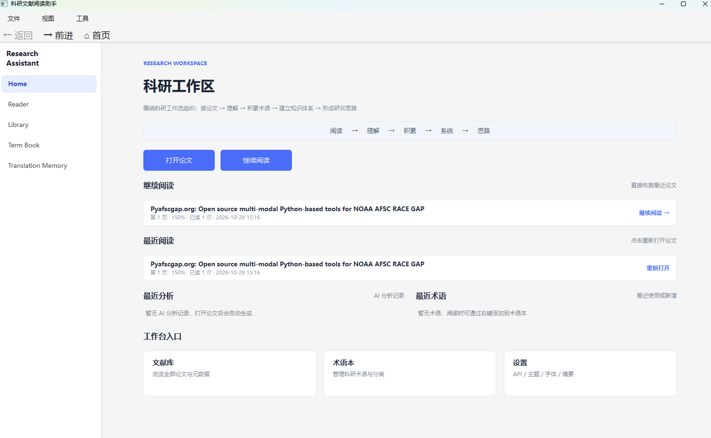
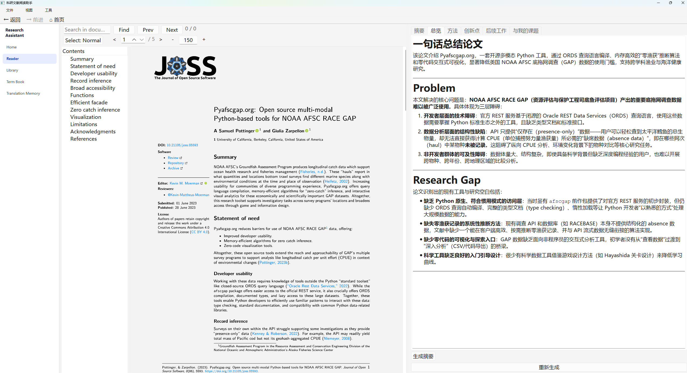
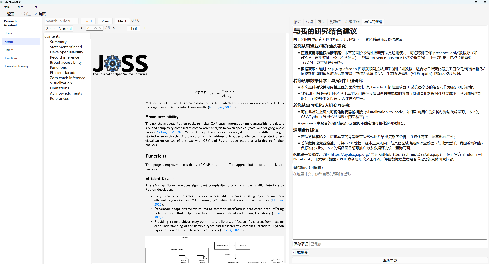
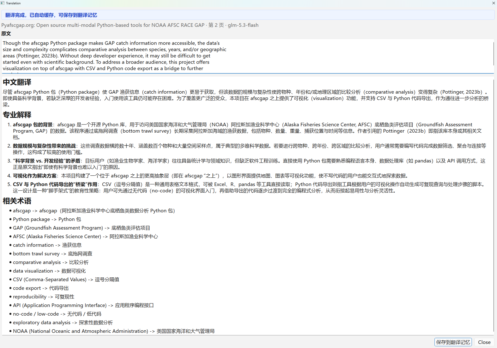

# ResearchOS｜科研文献阅读助手

ResearchOS 是我围绕科研论文阅读场景开发的 Windows 桌面应用，希望把 PDF 阅读、AI 辅助理解、划词翻译和术语整理放在同一个工作区里，减少在不同工具之间来回切换。

本仓库展示产品界面、设计思路和技术概览，不包含应用源码、EXE 或安装包。

## 产品预览

### 1. 科研工作区

工作区提供论文打开、继续阅读、最近阅读、文献库、术语本和翻译记忆等入口。

### 2. AI 文献概览

通过 AI 整理论文概要、研究问题和研究缺口，帮助读者快速了解文章的主要内容。

### 3. 与研究课题关联

根据论文内容生成与研究方向相关的阅读建议，辅助判断哪些内容值得进一步关注。

### 4. 选中文本翻译

选中论文中的英文段落后，可以查看中文翻译、术语解释和相关术语。

### 5. 阅读过程演示

[观看约 45 秒的静音演示视频](assets/05-reading-ai-overview-45s.mp4)

视频展示 PDF 阅读和 AI 概览界面的使用过程。划词翻译请参考上方截图。

## 主要功能

目前作品集以 ResearchOS v0.1.1 为展示基线，主要功能包括：

- **PDF 阅读：** 目录浏览、翻页、缩放、文本搜索、文本选择和内部链接定位。
- **AI 辅助理解：** 文献概览、摘要及与研究课题相关的阅读建议。
- **学术翻译：** 选中文本翻译和成功结果缓存。
- **术语与翻译记忆：** 整理术语，主动保存有价值的翻译，并检索历史记录。
- **阅读管理：** 文献库、最近阅读和阅读位置恢复。

AI 服务由用户配置。模型输出仍需结合论文原文核对，尤其是专业术语、研究结论和引用依据。

## 产品设计思路

### 让 AI 功能融入阅读过程

我希望用户在阅读论文时就能处理遇到的问题，而不必频繁切换到其他工具。阅读、翻译、术语整理和历史记录因此被放在同一套工作流程中。

### 区分翻译缓存与主动保存

成功翻译可以缓存，方便后续复用；翻译记忆则用于保存用户主动选择保留的内容。两者分别服务于结果复用和知识整理。

### 明确模型处理范围

当前稳定版的分析与摘要入口最多传入前 30,000 个字符，因此不能将其描述为已经通过验收的长论文全文分析功能。分析和摘要也可能出现界面等待，模型输出需要人工核对。

## 技术概览

- **桌面界面：** Python、PySide6
- **PDF 阅读与文本提取：** Qt PDF、PyMuPDF
- **AI 分析与翻译：** 用户配置的 OpenAI 兼容 HTTP 接口
- **本地数据：** SQLite
- **凭据管理：** Windows Credential Manager

详细内容见：

- [产品案例](docs/PRODUCT_CASE_STUDY.md)
- [技术概览](docs/TECHNICAL_OVERVIEW.md)
- [验证范围与已知限制](docs/VALIDATION_AND_LIMITATIONS.md)

## 我的工作与 AI 协作

我负责从实际科研阅读场景中梳理需求、设计功能流程、使用应用并提供反馈，参与功能验收和版本迭代。

开发过程中，我使用 ChatGPT 辅助需求分析与任务拆解，使用 Codex 协助代码实现、检查和打包。这个项目也让我逐步把关注点从单个 AI 功能转向完整的阅读流程、功能边界和实际使用体验。

## 演示说明

截图和视频来自我实际运行 ResearchOS v0.1.1 时的演示，展示了 PDF 阅读、AI 文献概览、课题关联建议和选中文本翻译。

本次展示属于有限的人工演示，不代表已经完成系统化回归测试、性能测试或科研正确性评估。目前没有足够的数据支持普遍效率提升或模型准确率等量化结论。

AI 功能会将提取的文本发送到用户配置的模型服务商，可能产生费用。使用前应确认服务商的数据处理规则，并避免发送未经授权的保密材料。

## 示例论文来源

Pottinger, S. and Zarpellon, G. (2023). “Pyafscgap.org: Open source multi-modal Python-based tools for NOAA AFSC RACE GAP.” *Journal of Open Source Software*, 8(86), 5593. [DOI](https://doi.org/10.21105/joss.05593)。

论文截图标注的许可为 [CC BY 4.0](https://creativecommons.org/licenses/by/4.0/)。

本仓库仅用于产品作品集展示，不代表应用源码或第三方依赖已经获得新的开源授权。
