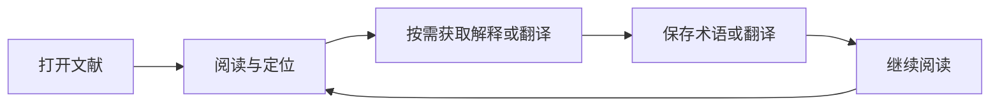

# ResearchOS 产品案例：围绕阅读流程组织 AI 辅助能力

> 本文为产品案例展示文档，描述范围以 v0.1.1 的已确认产品事实为准。产品分析与未来验证计划不等于已执行研究或已取得成果。

## 问题从哪里来

科研文献阅读不只包含翻页，还涉及定位内容、理解术语、获取翻译和保存有价值的信息。项目所针对的问题是：在阅读器、翻译工具和术语记录之间切换，容易打断阅读过程。

这一问题来自实际阅读反馈。现有依据不包含系统访谈、问卷样本、市场规模或竞品实验结果，因此不能据此声称痛点在某一人群中已得到普遍验证。

## 产品目标与范围

产品方向是把阅读、辅助理解与知识积累放在同一个工作区，让用户能沿着文献继续处理信息。是否减少切换、提高理解或改善知识留存，仍需后续观察和测量。

稳定版围绕 PDF 阅读、分析与摘要入口、翻译、术语本、翻译记忆、文献库和阅读历史展开。完整科研笔记系统尚处于设计阶段，不能把长期知识系统的愿景当作已交付能力。

## 核心工作流

这是对功能路径的概括，不是所有页面状态、自动触发条件或异常分支的完整交互图。配置真实凭据后，未缓存文献可能触发自动分析，启用自动摘要时还会请求摘要。本次演示在独立 Windows 用户下进行；使用真实凭据时仍需留意自动调用和费用。

| 阅读阶段 | 用户需要处理的事情 | 现有产品响应 | 尚待验证 |
|---|---|---|---|
| 进入文献 | 找到并继续上次内容 | 工作区、文献库、最近阅读、位置恢复 | 真实任务中是否更容易继续阅读 |
| 定位内容 | 查找段落或跳转引用 | 目录、搜索、页内链接、翻页与缩放 | 首次链接延迟对流程的影响 |
| 理解内容 | 理解文本、术语和文章概要 | 文本选择翻译、分析与摘要入口 | 输出对具体阅读任务的帮助及错误成本 |
| 保存信息 | 留下值得再次使用的内容 | 术语本、主动保存的翻译记忆 | 用户如何决定保存，后续能否找回 |
| 返回阅读 | 在同一工作区继续处理文献 | 阅读界面及阅读记录 | 是否实际减少切换或恢复成本 |

表中的“尚待验证”是研究问题，不是已有结论。

## 三项设计取舍

以下取舍依据已确认的功能结构进行产品分析，不冒充历史设计会议或已执行实验的记录。

### 1. 围绕阅读组织功能

稳定版将阅读、翻译、术语和历史放在同一个工作区。产品分析：这种组织方式旨在连接阅读中的前后步骤，使 AI 输出与具体文献任务相关联。

收益仍待验证；功能集中也会增加界面和状态管理的复杂度。现有稳定版的分析/摘要仍可能阻塞界面，说明流程整合不能代替性能与异常处理验证。

### 2. 区分成功结果缓存与用户主动收藏

成功翻译结果可以进入缓存；Translation Memory 则由用户主动保存。两者在现有产品中承担不同角色。

产品分析：缓存面向系统复用，主动保存表达用户的收藏意图。不能仅凭产生过翻译就认定用户已经完成知识积累。是否改善重复任务体验或提高后续检索价值，需要独立测量。

### 3. 明确 AI 能力和版本边界

稳定版提供分析与摘要入口，但入口最多传入前 30,000 个字符。后续存在全文阅读、分块证据和独立 Quick/Deep 等开发方向，这些不属于稳定版已验收成果。

产品分析：对外展示应让用户知道处理范围和证据等级。接口返回、离线逻辑检查、真实模型成功及科研正确性是不同问题，不能相互替代。长论文全文分析尚未通过真实验收。

## 版本迭代如何展示

| 阶段 | 有依据的状态 | 展示方式 |
|---|---|---|
| v0.1.1 稳定范围 | 产品说明记录用户于 2026-09-06 完成正式 EXE 版本级人工验收 | 描述稳定工作流与已知限制，不扩张为每项能力均完整验证 |
| 后续开发 | 后台分析、结果归属、完整性、分块证据、独立 Quick/Deep、全文 MVP 不属于上述稳定范围 | 仅标记为后续开发，不作为本次稳定交付成果 |
| 本轮展示素材（2026-10-29） | 用户在独立 Windows 用户下运行 v0.1.1，提供了 PDF 阅读、AI 概览、课题关联建议和选中文本翻译截图，并录制了短视频 | 属于有限人工演示证据，不代表完整回归、性能、兼容性或科研正确性验收 |

这是一张范围表，不是完整研发时间线。未确认的日期、人员投入和版本效果不补写。

## 负责人职责与 AI 协作

已确认的职责包括提出阅读需求、拆解问题、提供实际使用反馈和决定验收。ChatGPT 辅助产品与任务分析，Codex 辅助实现、自动化检查和打包。

案例可以用于讨论需求判断、流程组织、功能边界和验收标准，但不能据此宣称个人独立完成全部代码、领导了未经确认规模的团队或取得了未记录的业务增长。

## 后续验证计划

以下内容尚未执行：

1. 使用原创合成文献设置“定位内容—理解文本—保存信息—继续阅读”的任务，观察完成路径与卡点。
2. 分别观察缓存复用和主动收藏的使用情境，避免把两类行为合并成同一成功指标。
3. 对阅读体验、输出完整性、来源核对和科研正确性分别定义标准，再决定需要收集的证据。
4. 若要报告效率变化，先明确任务、比较条件、样本和测量方式，再记录结果；目前不填写目标收益为实际成果。

本轮没有进行正式回归测试、构建、性能测试、兼容性测试或科研正确性评估；展示素材不替代这些验证。任何新增用户研究或系统测试仍需单独规划与记录。

## 事实依据与待审核项

依据已审核产品说明中的阅读问题、核心工作流、稳定功能、缓存与翻译记忆区分、版本范围及人和 AI 的职责。上述设计分析和研究问题为本次案例整理，不作为新增实证事实。

待用户审核：目标用户表述、三项设计取舍是否准确反映个人产品判断，以及未来可公开展示的过程材料。用户规模、定量收益和完整研发时间线均待核实。
