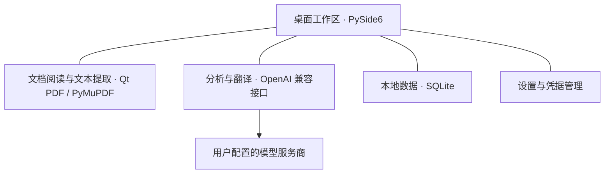

# ResearchOS 高层技术概览

> 本文只说明技术层次与模块职责，不提供应用源码、内部文件结构、安装命令、接口载荷或内部诊断记录。本目录不是可运行的技术交付物。

## 架构轮廓

ResearchOS 是以 Python 和 PySide6 实现的 Windows 桌面应用。文献处理、AI 辅助服务、本地数据和凭据管理共同支撑阅读工作区。

图中连线表示职责之间的概念关联，不是源码调用链、数据库结构或安全边界的完整证明。

## 模块与职责

| 模块 | 面向用户的职责 | 展示边界 |
|---|---|---|
| 桌面工作区 | 提供文献入口、阅读交互、术语和翻译记忆管理 | 只说明稳定范围，不把完整科研笔记系统算作已实现 |
| 文档处理 | 支持 PDF 阅读、目录、搜索、链接定位和文本提取 | 不将 OCR 或视觉信息完整理解描述为已完成能力 |
| 分析与翻译 | 使用兼容接口请求分析、摘要或翻译 | 服务商和模型由用户配置；输出需人工核对 |
| 本地数据 | 保存文献、术语、阅读记录和相关本地状态 | 本目录不附带用户数据库、配置或日志 |
| 翻译缓存 | 复用成功的翻译结果 | 不等于用户主动收藏或知识掌握 |
| 翻译记忆 | 保存用户主动选择保留的翻译并支持历史检索 | 不将自动生成结果全部视为用户已保存内容 |
| 设置与凭据 | 管理模型服务设置，使用 Windows Credential Manager 保存 Key | 配置文件不保存 Key；此说明不等于完成全面安全认证 |

## 数据流与用户应知的信息

阅读功能在桌面工作区中处理用户选择的文献。需要 AI 能力时，提取文本会发送到用户配置的模型服务商，可能产生费用。

配置真实 Key 后，打开未缓存文献会触发自动分析；启用自动摘要还可能产生摘要请求。演示时不能仅凭“未点击生成按钮”就假定没有模型调用；本次素材制作使用独立 Windows 用户，未把日常用户数据库或凭据复制到演示环境。

稳定版分析与摘要入口最多传入前 **30,000 个字符**，不等于把长论文全部内容交给模型，也不证明模型理解了已发送内容。

## 技术选择对应的产品问题

以下为基于已确认架构的产品解释，不是未经记录的技术选型实验结论：

- 桌面界面为阅读与知识整理提供同一交互空间；能否改善任务体验仍需验证。
- PDF 阅读与文本提取支撑“定位—理解”流程；链接延迟与截取范围会影响体验和结果边界。
- 成功翻译缓存与主动保存的翻译记忆分别服务复用和收藏意图。
- 兼容 HTTP 接口支持用户配置模型服务；不保证所有模型都具有相同质量、成本或兼容性。

## 稳定范围之外

后台分析、结果归属校验、完整性门禁、分块证据、独立 Quick/Deep 和全文阅读 MVP 属于后续开发。此文不将这些方向合并进 v0.1.1 的架构交付声明。

本次素材制作中，用户实际启动了 v0.1.1 并展示了 PDF 阅读、AI 概览、课题关联建议和选中文本翻译界面。该演示不等于完整的性能、可靠性、兼容性或安全测试；本轮未进行构建或系统化测试。

## 源码与许可状态

源码公开仍在进行第三方依赖许可审查。此目录仅提供产品案例文档，不附带应用文件、安装脚本、依赖包或第三方二进制文件；未选择或生成 LICENSE。

## 事实依据

依据已审核产品说明中的技术结构、稳定功能、凭据保存方式、AI 文本发送行为、输入截取范围及后续开发边界。架构图为原创概念示意，不是真实界面截图，也不是从内部源码提取的调用图。
