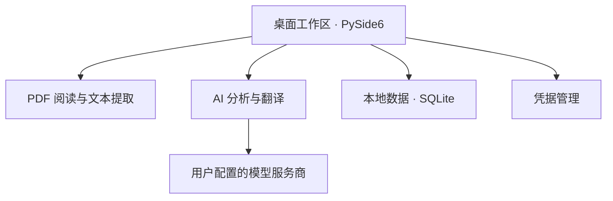

# ResearchOS 技术概览

ResearchOS 是一款基于 Python 和 PySide6 的 Windows 桌面应用，将 PDF 阅读、本地数据管理和 AI 辅助能力整合在同一工作区。

## 技术结构

## 主要模块

| 模块 | 技术与用途 |
|---|---|
| 桌面界面 | Python、PySide6，提供阅读和知识整理入口 |
| PDF 阅读 | Qt PDF、PyMuPDF，支持阅读、文本选择和文本提取 |
| AI 分析与翻译 | 通过用户配置的 OpenAI 兼容 HTTP 接口请求模型服务 |
| 本地数据 | SQLite，保存阅读记录、术语、翻译缓存及相关数据 |
| 凭据管理 | Windows Credential Manager，用于保存模型服务凭据 |

## 数据处理与使用边界

需要 AI 辅助时，应用会将提取的文本发送到用户配置的模型服务商，具体数据处理方式取决于所使用的服务。相关请求可能产生费用。

当前稳定版的分析与摘要入口最多传入前 30,000 个字符，尚不能据此认定长论文全文分析已经通过验收。分析和摘要也可能阻塞界面，模型输出需要人工核对。

成功翻译缓存与用户主动保存的翻译记忆承担不同职责：前者用于复用已有结果，后者用于保存用户希望再次查阅的内容。

当前版本尚未实现 OCR 和完整的科研笔记系统，长论文全文分析也尚未通过验收。

本仓库提供的是高层技术说明，不包含应用源码、EXE、安装包、配置、数据库或用户日志。第三方依赖的许可与分发问题仍需单独审查。
